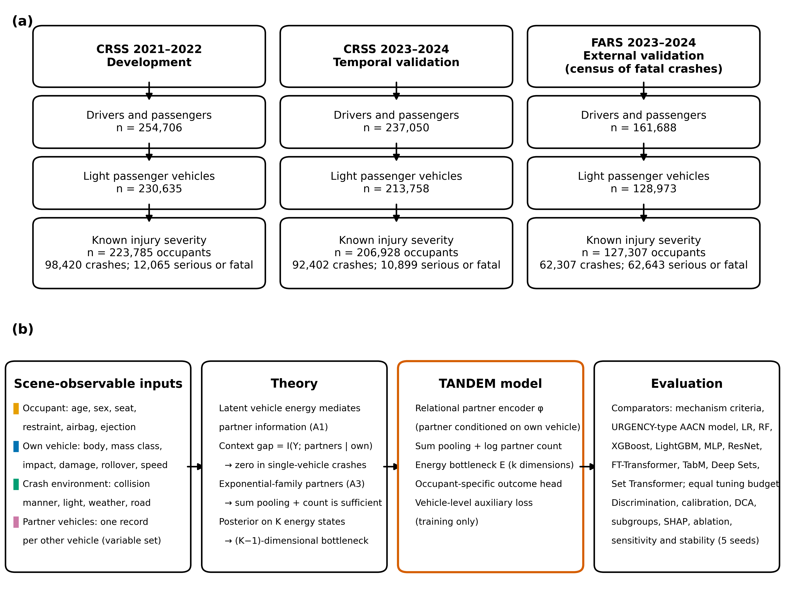
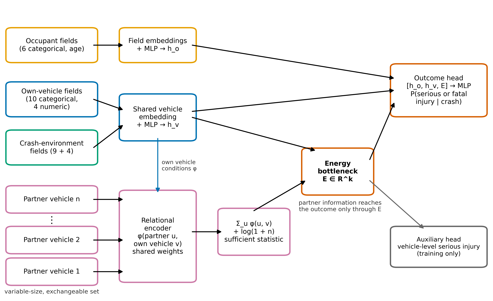
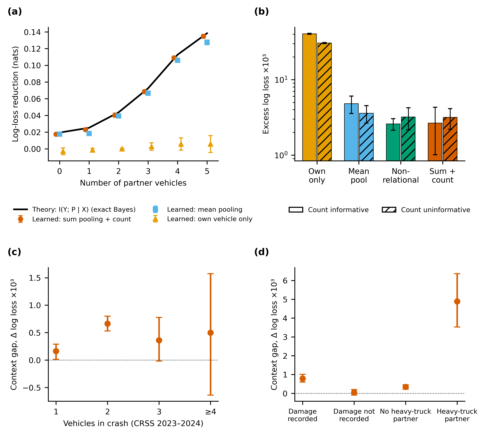
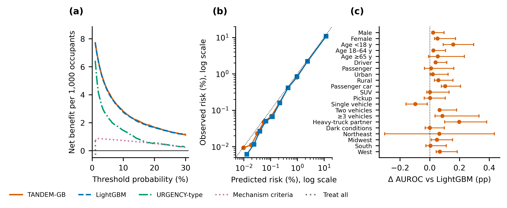

# TANDEM: Partner-Vehicle Information for Prehospital Serious-Injury Prediction

## Overview

Field-triage and automatic crash-notification models usually describe only the injured occupant and that occupant's vehicle. **TANDEM** treats a crash as a set of interacting vehicles and tests whether information from partner vehicles improves prehospital prediction of fatal or suspected serious injury.

Development and validation used **558,020 light-vehicle occupants** from two US national crash databases: the Crash Report Sampling System (CRSS) and the Fatality Analysis Reporting System (FARS).

> This public repository includes the project overview and selected figures. Analysis code, source data, manuscripts, and full tables remain private.

## Study design

| Cohort | Database and years | Occupants | Role |
|---|---|---:|---|
| Development | CRSS 2021–2022 | 223,785 | Model development |
| Temporal validation | CRSS 2023–2024 | 206,928 | National temporal test |
| External validation | FARS 2023–2024 | 127,307 | Fatal-crash external test |

Inputs were limited to scene-observable occupant, own-vehicle, crash-environment, and partner-vehicle information.

## Model

TANDEM uses a relational partner encoder, sum pooling with an explicit partner count, and a low-dimensional energy bottleneck. The theory characterizes the value of partner information as conditional mutual information and predicts no true information gain in single-vehicle crashes. A cross-fitted variant combines learned energy scores with a gradient-boosted outcome head (**TANDEM-GB**).

## Main findings

| Result | TANDEM-GB | Comparator |
|---|---:|---:|
| Temporal survey-weighted AUROC | **0.931** (95% CI 0.925–0.937) | LightGBM 0.930 |
| External FARS AUROC | **0.906** (95% CI 0.904–0.908) | LightGBM 0.905 |
| Temporal AUROC vs. AACN-type model | **0.931** | 0.874 |
| Temporal AUROC vs. mechanism criteria | **0.931** | 0.541 |

The temporal AUROC difference from LightGBM was very small and not statistically significant, although log loss and Brier score improved. The external AUROC difference was also small but statistically supported.

Partner information reduced weighted log loss by 0.664×10⁻³ in two-vehicle crashes and by 4.887×10⁻³ when a medium or heavy truck was among the partners, compared with 0.164×10⁻³ in single-vehicle crashes. In FARS, partner information increased AUROC from 0.829 to 0.872 in two-vehicle crashes and provided no gain in single-vehicle crashes.

TANDEM-GB and LightGBM had similar net benefit across clinically relevant thresholds. To reach 90% sensitivity, TANDEM-GB flagged 20.2% of occupants, LightGBM 20.5%, and the AACN-type comparator 33.4%. The gain was concentrated in multi-vehicle crashes, consistent with the proposed mechanism.

## Interpretation

Partner-vehicle data contain measurable predictive information, especially when the collision involves a heavier partner. The gain over strong gradient boosting was modest; the primary contribution is a theoretically guided representation of crash context and evidence about where that context helps.

## Limitations

- Injury severity was police reported rather than clinically adjudicated.
- FARS contains fatal crashes and therefore differs strongly in case mix from CRSS.
- Some potentially useful telemetry, including measured change in velocity, was unavailable.
- Prospective validation in emergency-response workflows is required.

## Repository scope

Only `README.md` and four selected main figures are public. This work is for research communication and is not a field-triage device.
